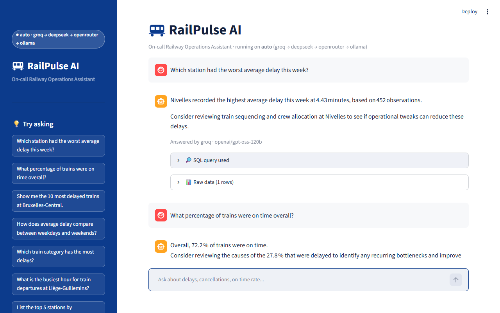
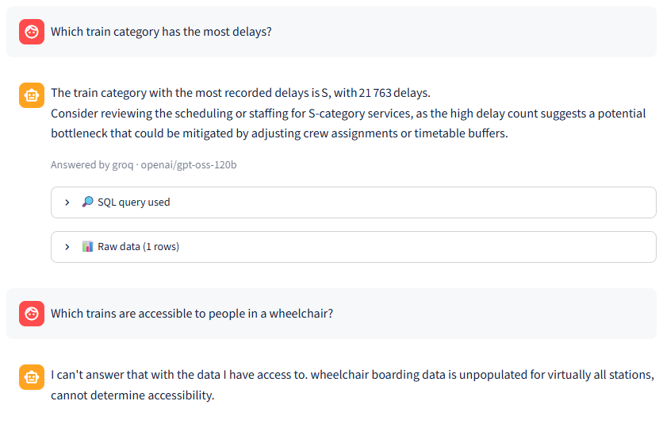
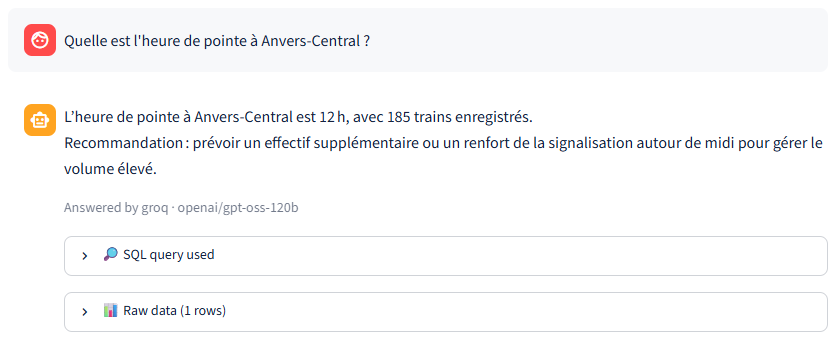
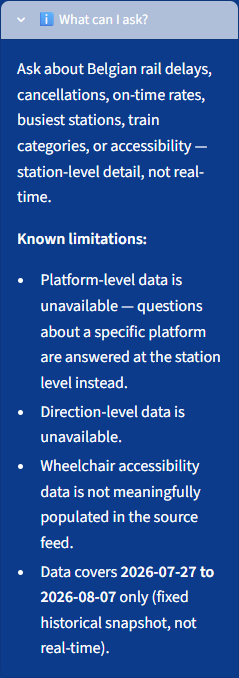

# RailPulse AI: Intelligent Transit Insights

I built an on-call Railway Operations Assistant. Station managers ask questions about Belgian rail
delays in plain language and get answers backed by SQL, with a short tactical recommendation. It runs
on Groq's free tier by default (`LLM_PROVIDER=groq`). With `LLM_PROVIDER=auto`, the `.env.example`
setting, Groq answers first and SambaNova, DeepSeek, OpenRouter and a local Ollama take over in that
order when it can't.

## Overview

- **Type:** Learning challenge (solo)
- **Duration:** 5 days
- **Stack:** Python, SQLite, Streamlit, FastAPI, LLM via Groq, SambaNova or OpenRouter (free tiers), DeepSeek (paid API) or Ollama (local)
- **Data source:** exported from my RailPulse Power BI dashboard (Sprint 3), itself fed by my Azure ingestion pipeline (Sprint 2)
- **Power BI dashboard:** [`powerbi/railpulse.pbix`](powerbi/railpulse.pbix), the same 99,014 stop events as the SQLite database, with Explorer and Station Drill-down pages (slicers, category → route → station and day → hour drill-downs). Source project, queries and data: [railpulse_power-bi](https://github.com/Siegried81/railpulse_power-bi)
- **Live demo:** [Streamlit](https://railpulse-genai.streamlit.app/) · [Render](https://railpulse-genai-1.onrender.com/). Both are free tier, so the first request after a quiet spell takes about 50 s while the app wakes up.

## Features

- **Text-to-SQL.** One LLM call turns the question into a single SQLite `SELECT`, which runs on a read-only connection.
- **RailPulse Consultant.** A second call turns the rows into a short operational recommendation instead of a raw table.
- **Measured accuracy.** `scripts/eval_text_to_sql.py` scores the SQL step on 40 golden questions by running the model's query and a reference query and comparing the results. Live on Groq `gpt-oss-120b`, 2026-11-23: 40/40, and 33/33 on the
  questions that are not in the few-shot examples (`reports/eval_text_to_sql.md`). The run before it
  scored 39/40; the miss came from the prompt, see Known Limitations.
- **Safety guardrails.** Only one `SELECT` gets through. Write keywords, comments, SQLite internals and a few dangerous functions are blocked, every table after `FROM`/`JOIN` must be one of the five real tables, and every quoted column must exist in a table the query reads. The connection itself is read-only, with a 5 s budget and a 500-row cap.
- **No invented figures.** Every number in an answer must appear in the question or in the result rows the model was shown. The SQL is not counted as evidence: a `/ 60.0` in the query does not make "60 minutes" true. An answer that fails is regenerated, and if it still fails the UI says which figures could not be checked.
- **Minutes, not seconds.** Delays are stored in seconds and converted to minutes in Python before anyone, the model included, sees them.
- **Several LLM providers, one switch.** `LLM_PROVIDER` picks Groq, SambaNova, DeepSeek, OpenRouter or Ollama with no code change. In `auto` mode the Groq keys rotate on a rate limit, a cut-off or malformed answer moves on to the next provider, and every answer records which provider and model wrote it.
- **Audit log.** `query_audit.log` gets one line per query (run, blocked or timed out) and one per LLM call, with provider, model, a hash of the prompt, latency, token counts and outcome. Prompt text is not logged.
- **Chat UI.** Example questions in the sidebar, SQL and CSV export on every answer, an SNCB-inspired navy and grey theme.
- **Weekly executive brief.** `scripts/generate_weekly_report.py` computes the week's top delay anomalies, on-time rate and worst station in SQL, then has the LLM write a Markdown brief in `reports/`. The same figure check applies; a brief that fails it is not written.

## Screenshots

Taken on 6 November 2026 against the local app, answered by Groq `openai/gpt-oss-120b`.



A grounded answer next to a declined one: wheelchair data is empty in the feed, so the assistant says so instead of guessing.



A question in French gets an answer in French.



The sidebar lists what the data can't answer.



## Setup

### 1. Clone and install dependencies

Python 3.11 is the version CI and the Docker image use.

```bash
git clone https://github.com/Siegried81/railpulse-genai.git
cd railpulse-genai
python -m venv .venv
.venv\Scripts\Activate.ps1      # Windows PowerShell
# source .venv/bin/activate     # macOS / Linux
pip install -r requirements.txt
```

### 2. Build the database (optional)

The repo ships `data/railpulse_ai.db`, so skip this unless you want to rebuild it from your own
export. Put the CSVs (`liveboard_records.csv`, `stations.csv`, `routes.csv`, `trips.csv`,
`vehicles.csv`) in `data/` and run:

```bash
python scripts/build_database.py
```

The new database is built in a temporary file and checked first: one row per stop event, no missing
key or delay, every "Delay Severity" label inside its delay range, ISO dates, and the same columns the
guardrails allow. Only a build that passes every check replaces `data/railpulse_ai.db`; a failed one
leaves the old database where it was. A missing CSV fails the build.

### 3. Configure your LLM provider

You need at least one key (or a local Ollama) before the app can answer anything. Copy
`.env.example` to `.env` and pick a provider.

**Groq (hosted free tier, the default)**
```
LLM_PROVIDER=groq
GROQ_API_KEY=your_key_here
GROQ_API_KEY_2=optional_second_key
GROQ_MODEL=openai/gpt-oss-120b
```
One Text-to-SQL prompt is about 3.7K tokens (3,732 to 3,747 measured). Groq's free tier caps
`gpt-oss-120b` at 8K tokens a minute and 200,000 tokens a day, which is about 50 questions a day.
The daily cap applies to the whole Groq account, not to each key: extra keys `GROQ_API_KEY_2`,
`_3`, … (numbered without gaps) are rotated through on a rate limit, but they only add capacity
when they come from different accounts.

**Auto (Groq, then SambaNova, DeepSeek, OpenRouter, Ollama)**
```
LLM_PROVIDER=auto
GROQ_API_KEY=your_key_here
SAMBANOVA_API_KEY=your_key_here
DEEPSEEK_API_KEY=your_key_here
```
A provider is skipped when it fails, is rate-limited, sends a malformed reply or stops at its token
limit before finishing. SambaNova comes second because its free tier has its own quota, so a Groq
rate limit doesn't spend paid DeepSeek credit. SambaNova without a key is skipped before any request;
DeepSeek and OpenRouter without a key cost one rejected request each before the chain moves on. When
every provider fails and at least one was only rate-limited, the call waits and tries again.

**OpenRouter (hosted free tier)**

Sign in at [openrouter.ai/keys](https://openrouter.ai/keys):
```
LLM_PROVIDER=openrouter
OPENROUTER_API_KEY=your_key_here
OPENROUTER_MODEL=openrouter/free
```
`openrouter/free` is OpenRouter's own auto-router. Its free model IDs rotate and get delisted often,
so pinning one risks a 404 later.

**Ollama (fully local, no signup)**
```bash
ollama pull llama3.2:3b
```
```
LLM_PROVIDER=ollama
OLLAMA_MODEL=llama3.2:3b
```

`LLM_PROVIDER=anthropic` also exists in `app/config.py`. I used it for quick prototyping only; it is
not part of the free, open-source path.

### 4. Run the app

```bash
python -m streamlit run app/streamlit_app.py
```
`python -m streamlit` rather than the bare `streamlit` command avoids the
`ModuleNotFoundError: No module named 'app'` some environments hit.

### 5. HTTP API (optional)

The same pipeline over plain HTTP, for other services and front ends:

```bash
python -m uvicorn api.main:app --port 8003
```

- `GET /api/health`: liveness probe, always open
- `GET /api/config`: provider and model in use, no keys
- `POST /ask` with `{"question": "..."}`: the answer, SQL, rows, who answered and any ungrounded figures

Before you expose it, set `RAILPULSE_API_KEY` (callers send it as `X-API-Key`) and
`RAILPULSE_RATE_LIMIT_PER_MINUTE`. Both are off by default; `/api/health` stays open. The Docker image
does not include the API.

## Deployment

Live off `main` on [Streamlit Community Cloud](https://railpulse-genai.streamlit.app/) and [Render](https://railpulse-genai-1.onrender.com/), both free tier. On Render it runs as a **Python** service, not from the `Dockerfile`: that image pins Streamlit to 8501 and Render serves on `$PORT`. Keys live in each platform's dashboard, never in the repo. The app is open to anyone with the link, so it spends my Groq quota. The HTTP API above isn't deployed there, so `RAILPULSE_API_KEY` has nothing to guard on these demos.

The full walkthrough (exact start command, the Docker trap, what that API key really does, why the same average used to print different decimals) is in [`docs/deep-dive.md`](docs/deep-dive.md).

GitHub Actions runs ruff and the test suite on every push. `publish.yml` runs that same job first and only builds and pushes the Docker image when it passes.

## Project Structure

```
├── app/
│   ├── config.py           # provider + DB configuration
│   ├── llm_client.py       # call_llm() / call_llm_until(), provider chain, LLM_CALL audit lines
│   ├── db.py               # read-only SQLite connection + safe execution
│   ├── guardrails.py       # SQL safety validation
│   ├── prompts.py          # Text-to-SQL, consultant and weekly-report prompts
│   ├── sql_utils.py        # SQL extraction, consultant input (delays in minutes), figure check
│   ├── engine.py           # generate_sql() and answer_question(), shared by the UI, the API and the eval
│   └── streamlit_app.py    # chat UI
├── api/
│   └── main.py             # FastAPI: GET /api/health, GET /api/config, POST /ask (optional key + rate limit)
├── evals/
│   └── text_to_sql_golden.json   # 40 questions with reference SQL or an expected NO_QUERY
├── scripts/
│   ├── build_database.py         # CSV -> SQLite, with polling dedup and post-build checks
│   ├── eval_text_to_sql.py       # execution-accuracy eval (offline by default, --live spends quota)
│   ├── check_values.py           # prints real column values used to ground the prompts
│   ├── generate_weekly_report.py # weekly executive brief
│   ├── red_team.py               # opt-in live red-team probe (spends quota, double-gated)
│   └── spark_aggregate.py        # PySpark mirror of the snapshot dedup, local mode
├── tests/                  # offline pytest suite (all LLM calls mocked)
├── test_pipeline.py        # live smoke test against the configured LLM
├── ruff.toml               # lint rules CI enforces
├── requirements.txt        # app runtime deps
├── requirements-dev.txt    # + pytest, pytest-cov, ruff, httpx (TestClient), debugpy
├── requirements-spark.txt  # pyspark, only for scripts/spark_aggregate.py
├── .streamlit/
│   └── config.toml         # theme colors
├── data/
│   └── railpulse_ai.db
└── reports/                # weekly brief and eval report
```

### Tests and evaluation

```bash
pip install -r requirements-dev.txt
python -m ruff check .
python -m pytest
python scripts/eval_text_to_sql.py          # offline: every reference query still runs
```

The suite runs offline: every provider call is mocked and outside connections are blocked, so a test
that forgets a mock fails instead of spending quota. `test_pipeline.py`, `scripts/red_team.py` and
`scripts/eval_text_to_sql.py --live` call the real LLM and spend quota. The Spark mirror's tests skip
unless you `pip install -r requirements-spark.txt` and have Java 17 or newer (`JAVA_HOME` or PATH).
On 2026-11-23 the mirror ran on the full export: 980,868 snapshots to 99,014 stop events, the same
99,014 `record_id`s the pandas build keeps, in 31 s in local mode. On Windows, Spark can compute but
cannot write its output without Hadoop's `winutils.exe`; run the CLI from WSL or Linux.

## Data Schema

I load 5 tables into SQLite from my Power BI export.

**`liveboard_records`** (main table, 99,014 rows after dedup): one row per train stop event
`record_id`, `station_id`, `vehicle_id`, `platform`, `scheduled_time`, `delay_seconds`,
`canceled`, `pulled_at`, `stations.station_id`, `Stations Name`, `stations.standard_name`,
`stations.latitude`, `stations.longitude`, `stations.wheelchair_boarding`, `stations.location_type`,
`vehicles.vehicle_id`, `vehicles.vehicle_type`, `vehicles.direction`, `Hour`, `day_of_week`,
`day_number`, `Delay Severity`, `Scheduled Date`

`stations.station_id` and `vehicles.vehicle_id` are copies of `station_id` and `vehicle_id`, equal on
every row.

**`stations`**: station reference data
`station_id`, `name`, `stations names`, `latitude`, `longitude`, `wheelchair_boarding`, `location_type`

**`routes`**: GTFS static route reference
`route_id`, `route_short_name`, `route_long_name`, `route_desc`, `route_color`,
`route_text_color`, `route_type`, `route_url`, `agency_id`, `train_category`

**`trips`**: GTFS static trip reference
`trip_id`, `route_id`

**`vehicles`**: vehicle reference
`vehicle_id`, `vehicle_type`, `direction`

> `liveboard_records` is already denormalized with station and vehicle info joined in,
> so most questions need no JOIN.

## Key Challenges

- **Massive duplicate polling records.** `liveboard_records` comes from continuous GTFS-Realtime
  polling: a stop that is still upcoming gets captured again on every poll until the train leaves.
  That gave 980,868 raw rows for 99,014 distinct stop events, and a stop polled more often weighed
  more in every on-time rate, ranking and average. `scripts/build_database.py` keeps only the latest
  snapshot per stop event `(vehicle_id, station_id, Scheduled Date)`, chosen by `pulled_at`. A first
  version keyed on `(vehicle_id, Scheduled Date)` kept one station per train per day and silently
  dropped about 87% of real stops from every station figure.
- **A JOIN that dropped 13.6% of the data.** 13,453 of the 99,014 stop events have a `vehicle_id`
  with no matching `trip_id`. The train-category example in the prompt used a plain JOIN, so those
  stops vanished from every category figure without a word. It is now a `LEFT JOIN` that shows them
  as 'Unknown', and a test stops a plain JOIN on `trips` from coming back.
- **Free-tier LLM instability.** Groq's signup was broken for the whole class, so I added
  OpenRouter. Its auto-router sometimes picked a reasoning model that dumped its chain of thought into
  the answer, or spent its whole token budget before writing any SQL. Passing
  `reasoning: {exclude: true}` and never using the `reasoning` field as an answer fixed it. Later,
  the first live runs of the eval were refused with a 429 on almost every call. The code threw away
  the provider's reason; once it was kept, it named the real limit: 200,000 tokens a day per Groq
  account, shared by every key of that account. The eval also used to count those refusals as wrong
  answers ("2/40"); a case the model never answered is now "not measured" and stays out of the score.
- **Windows `ModuleNotFoundError`.** `streamlit run app/streamlit_app.py` sometimes failed to
  resolve the `app` package on Windows. `python -m streamlit run ...` fixed it.

## Known Limitations

- **"Today", "this week", "recently"** mean the most recent date in the data
  (`MAX("Scheduled Date")`), not the calendar date. The data is a fixed snapshot, 2026-07-27 to
  2026-08-07, so the real current date would always return zero rows.
- **Platform-level data** is empty at ingestion. Platform questions are answered at station level,
  and the answer says so.
- **Direction-level data** is empty for every record; direction questions are declined.
- **Cancellations** (`canceled`) are 0 for every record. The source feed does not report them, so
  "0 canceled trains" is a gap in the feed, not a perfect record, and the assistant says so.
- **Wheelchair accessibility** is NULL for every station in this feed.
- **Train category** is unknown for 13.6% of stop events (no matching trip); they appear as 'Unknown'.
- **The SQL score is 40 questions, one run.** 40/40 live is a small sample on questions written
  by the same person as the prompt, not a guarantee on any question. A live run costs about 150K
  Groq tokens, most of one account's daily cap. The first run missed one case: the few-shot read
  "the most delays" as a count of delayed stops for the hour and as an average for the train
  category, and the model used the count for both. A count follows traffic (S trains "won" with
  21,763 delayed stops because they make 34,499 stops), so the prompt now defines it as the highest
  average delay, with the same 100-stop minimum as station rankings.
- **`WITH ... SELECT` (CTE) queries are not supported.** The guardrails accept a single plain
  `SELECT`; a CTE is rejected with a clear message and the model is asked again.
- **Answers can differ between providers.** In `auto` mode the provider that answers depends on
  quotas at that moment, so the same question can get different wording or rounding. Each answer
  names the model that wrote it.
- **The figure check has known gaps.** A whole number passes when it is within 0.5 of a real value
  ("5" for 4.6), and a date is checked as three separate numbers.

## Author

Siegried Camus, BeCode AI & Data Science bootcamp
